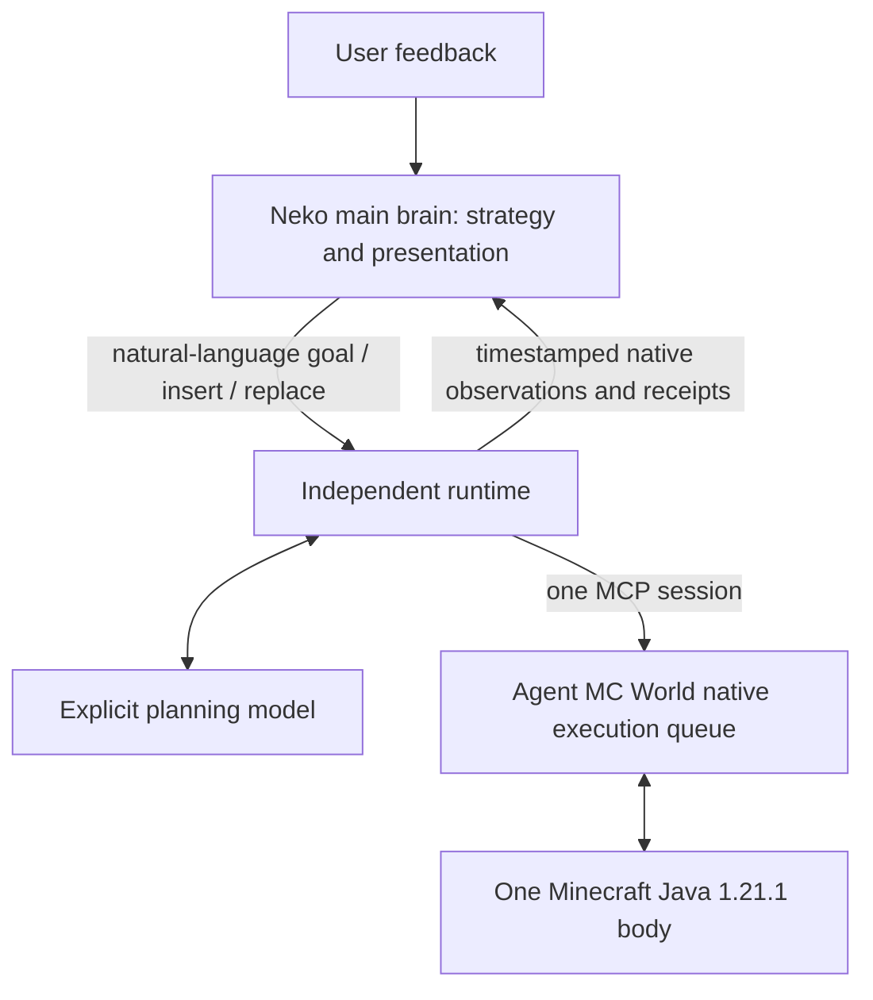

# Minecraft Autonomous — architecture

## Responsibilities

The current architecture separates three responsibilities:

1. **N.E.K.O main brain:** high-level goals, strategy, user feedback and character presentation,
   including narration, voice and emotion. These stay in Neko's main conversation flow.
2. **Independent runtime:** refine the active goal through an explicitly selected `Planner`,
   consume world events, construct bounded requests, submit native work and retain evidence.
3. **Agent MC World:** own the actual queue, checkpoints, skills, reflexes and Mineflayer body.
   `mc_queue`, `mc_do` receipts and task events determine what is running.

`agent-mc-autonomy` in minecraft-ai-friend owns the runner/controller, context, goals and review lifecycle. This plugin installs a pinned dependency; its `autonomy/` namespace and `standalone.py` only provide compatibility forwarding. `HttpPlanner` uses an explicit endpoint and model; `NekoPlanner` can supply
inference through the public `decision` slot in embedded mode. That slot does not automatically
include Neko's main persona, memory, speech or main-conversation context.

The plugin exposes observations for presentation. It does not implement a new speech pipeline or
automatically broadcast planner text. Live main-brain narration/voice integration remains unverified.

## Continuous execution and feedback

No fresh user message is required to continue the standing goal or an accepted submitted goal.
Native actions continue themselves; terminal receipts and relevant events wake the planner.
Unchanged snapshots do not cause empty model requests. `max_decisions=0` removes the session's
decision-count limit; request timeouts, context and per-turn rounds remain bounded. Explicit stop,
connection errors, exhausted model recovery and uncertain action outcomes still end the session.

SQLite is a durable goal/command inbox with UUID deduplication and delivery receipts, not a second
body queue. It holds up to 64 outstanding ordinary commands; stop remains admissible when full.
Only the session owner consumes it:

| Command | Effect |
| --- | --- |
| `submit_goal` | Queue a natural-language goal until the active goal reports and native work finishes. |
| `feedback(insert)` | Cancel stale inference, pause the old goal, plan through native `afterCheckpoint`, then resume the previous goal. |
| `feedback(replace)` | Cancel stale inference; archive the original native `mc_stop` receipt before superseding current and paused goals and adopting the replacement. |
| `submit_steps` | Deliver already planned `mc_do` steps using explicit append / afterCheckpoint / now. |
| `stop` | Stop planning, cancel undelivered intents and disconnect only the owned body. |

The native executor may resume earlier work between inserted steps. Task ownership prevents that
earlier work from blocking the inserted goal's result report. Nested feedback restores the latest
paused goal and any not-yet-applied queue policy. Newly planned actions default to append: upstream's
omitted-mode default would replace waiting tasks. Feedback body plans must use `mc_do`; scripts
cannot bypass the requested queue policy.

`queued`, `planning` and native `accepted` describe different stages. A planner's `goal_report`
is always unverified, with observed facts and the original receipt archive path. An insertion can
report after its own tasks terminate while the previous goal's native task remains active.
A blocked report also allows the earlier goal to resume. Accepted actions and terminal receipts
alone do not establish that the high-level goal was achieved.

`run --queue-only` needs no planner for already planned native tasks and built-in reflexes. Arbitrary
new natural-language goals require a planner; queue-only mode reports them as blocked instead.

## Ownership, stop and recovery

- Startup/import/status are passive. Gameplay needs explicitly enabled configuration and run/start.
- In external mode, Neko observes and submits commands. Closing its frontend leaves the independently
  launched runtime alone. Explicit stop is a command whose disconnect evidence must be checked separately.
- In embedded mode, one worker thread owns an asyncio loop, planner, MCP session and child across host
  entry loops; shutdown stops that runtime. Stop invalidates in-progress starts before awaiting configuration.
- Both frontends use the same configured data root and server/account identity. An OS-backed lease rejects
  a second owner. Backend/planner changes do not change the ledger directory.
- Persist the request before dispatch; archive originals before acknowledging native barriers. Unknown
  delivery, unfinished native execution after a crash or a dispatching mailbox entry blocks replay.
- Last-observed status is timestamped and declares `live_verified=false`; file existence does not prove
  process liveness. Standing/current goals and native observations remain available to the frontend.
- Confirm generic-core disconnect before clearing pending executions. This rule must not be reused for
  Numen, whose remote body can remain alive. No automatic restart, endpoint fallback or replay is added.

## Context, source and compatibility

Requests keep stable rules and curated schemas first, complete assistant/tool pairs next and current
facts/events last. Fresh facts replace old snapshots. Long schemas and originals remain queryable on
demand. The byte budget is conservative; real tokenizer and prefix-cache hit rates have not been measured.
Space reserved for fresh state is calculated after the fixed prefix. The latest complete tool exchange
is retained if it fits, so a rejected call remains visible to the next decision. Incomplete HTTP model
responses are privately journaled and never dispatched; the event loop permits two delayed recovery
attempts, stopping after three consecutive failures. This does not retry uncertain native actions.

The optional frontend exposes public LLM tools for bounded state/fact pages, natural-language intent
and explicit stop. These tools use the existing command mailbox; they do not create another planning,
speech or physical action loop. Automatic game-event narration still needs separate acceptance.

The pinned core is `minecraft-ai-friend@7889ce261a2309d94400b739c6198468d8271d83`, with the reviewed
standalone cleanup patch and headless receipt in `agent_mc_autonomy/core_distribution/source.json`（来自固定版本框架依赖）. This change does not upgrade
that core or add Cortico runtime dependencies. See the [upstream audit](research/upstream-autonomy-2026-10-13.md).

## Main-character decision heartbeat

`neko_heartbeat.py` belongs only to the Neko adapter. It claims a framework-produced envelope and
delivers that bounded review notification to the actual character session via public
`push_message(ai_behavior="respond")`. This is distinct from binding a generic model
to the independent planner's `decision` slot. Neither route imports the other host.

The framework owns scheduling: fresh material changes and non-observation task results trigger coalesced reviews;
a slower periodic review includes the latest goal, queue, failures and the duration
of unchanged material facts. A death/failure observation can supersede an ordinary
review, but never directly cancels body work. The public notification API is not
claimed to reproduce another host's token/tool interruption semantics.

The main brain acknowledges `continue` or selects `insert` with a concrete stage goal.
`inspect` exposes bounded evidence without another model call in the plugin. One
durable review ID maps to one command UUID. An atomic mailbox intent-revision
precondition prevents an old review from overriding a newly queued user goal/stop.
Only the independent controller manages native `begin_turn`, barriers and `end_turn`.
Main-character acknowledgement, mailbox acceptance, task completion and voice playback
remain separate observations. User feedback and explicit replacement keep their existing
public intent entry. Defaults remain passive until enabled and the game is explicitly run.

Minecraft Java protocol is fixed at 1.21.1, with explicit offline/Microsoft authentication and remote
server configuration. No server launcher, extra player, model/GPU discovery or voice discovery is added.
Built-in viewer/console stays disabled because upstream assets target 1.20.6. An external viewer URL is
informational until its real data, frames and body identity have been verified.

The optional My Agent World native adapter needs its own SDK/world-adapter closure and body ledger.
It is not connected by this generic Mineflayer plugin. A version string cannot satisfy a custom
NeoForge handshake or registry. See [native-adapter evaluation](research/agent-mc-world-04-integration.md).

## Verification boundary

Embedded inference uses public Neko usage aliases: decision (text/tools), vision (image/text/tools),
and optionally fast (structured choice over chat tools). Provider configuration stays with the host.
An unavailable decision route preserves native observation and retries no sooner than 60 seconds;
this is degraded execution, not arbitrary planning without a model. Missing/invalid vision responses
fall back once to text and suppress further vision attempts for 60 seconds.

Only bounded PNG artifacts from the current MCP connection's mc_view_map/mc_visual can enter a
request. They expire after 15 seconds, consume an 8192-token conservative reservation and appear
once at the final user message. Cached artifact retrieval cannot refresh capture age. The headless
pin has no matching 3D viewer; an inventory map is explicitly distinguished from a camera frame.

Fast focus is optional advice at a planning checkpoint, not a replacement physical controller.
Rules handle emergencies/pending work without inference. Configured System One or Neko selection
has a 2-second deadline, finite allowlisted distributions, confidence checks and a 60-second error
cooldown. Only selected current facts and the bounded goal are sent; no full persona/history or images.
External mode cannot read or override standalone provider credentials via Neko model configuration.

The hosted panel projects allowlisted settings and bounded audit tails through public SDK UI
context/actions. Opening/refreshing is passive. Settings save does not launch/restart gameplay;
embedded active settings are rejected until explicit stop. Model diagnostics are explicit actions
using a neutral tool and synthetic calibration image, never dispatched to the native executor.

Offline tests exercise SDK-free startup, repeated autonomous actions without user input, native feedback
insert/resume, replacement, stale inference cancellation, deduplication, process ownership and uncertain
outcome refusal. They use fake models and bodies with network/process launching forbidden. The separate
disconnected MCP check starts only its network-denied child, without connect or model calls.

Before publishing, verify a configured server login, movement/collection/crafting, feedback during a long
action, explicit stop, connection loss, long-running survival, Neko presentation and actual viewer binding.
The old unattended stack remains stopped. The user subsequently authorized a separate vanilla test
server and runtime; actual observations and remaining limits are recorded in the
[dated live-acceptance report](vanilla-live-acceptance-2026-10-13.md).

## Canonical source ownership

The implementation and offline gameplay-policy tests live in minecraft-ai-friend/packages/agent-mc-autonomy. Neko owns no review triggering, material-change selection, retry policy or body queue. Its timer calls ReviewPort.offer and transports an envelope into the actual character session; the public tool calls ReviewPort.decide. Runtime publication alone calls observe. SQLite reviews reconcile a lost review commit against the durable goal mailbox. Optional review storage failure does not stop gameplay. The old plugin-side policy draft was never deployed.

The sibling agent-mc-world stays a model-free body; this explicit, optional orchestration package supplies the independent HTTP planner and host-neutral ports. A direct model needs no persona SDK. Rendering stays in mc-visual-console, and voice stays in the selected host. Closing an external adapter does not shut down this standalone runtime.
