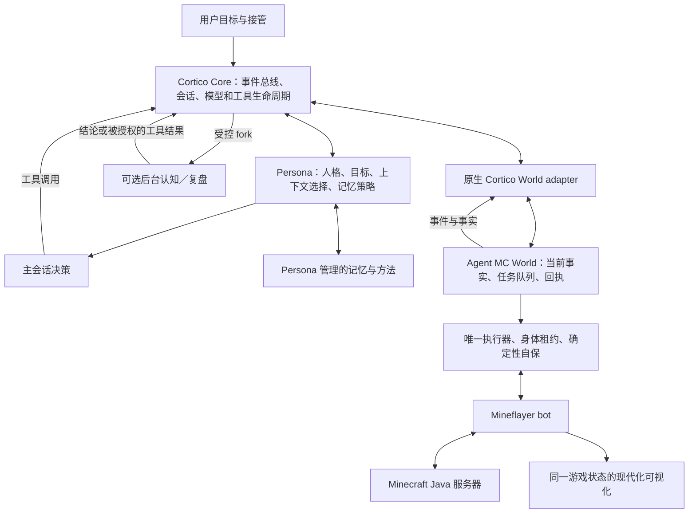

# Cortico 宿主怎样驱动 Minecraft，以及迁移时应保留什么

后续用户已明确要求彻底解耦：本报告用于识别值得保留的行为，不授权把 Cortico 运行时接入新插件。当前实施方向见[用户 fork 差异与迁移边界](fork-improvements-and-decoupling-boundary.md)。

研究日期：2026-10-13。本文核对固定源码及项目自身文档；没有启动 Cortico、N.E.K.O、模型、Minecraft 或任何服务器连接，没有做线上性能对比。用户反馈“Cortico 加这套 Minecraft 仓库运行不错”是有价值的实际使用反馈；本文解释可能支撑这种表现的机制，不把它当作本次测出的成功率、时延或缓存命中率。

## 1. 研究范围与版本边界

- Minecraft 独立源码：`D:/neko-plugins/_sources/cortico-world-qiandengji`，提交 `084234b24f816562d6493da9d57fe9f11b0a7874`。
- 当前插件已安装的独立执行层：`local/backend/node_modules/agent-mc-world`，版本 `0.3.0-next.2`。其 `release-sources.json` 指向 `jcs130/Cortico@8c00fbb022ea82fc9725301fde0437ccc00fdcc9`，同时列出 Minecraft 补丁；因此“Cortico 原始引擎”与“独立包生成后的引擎”必须区分。
- 本次只读取得并固定的 Cortico：`D:/neko-plugins/_sources/Cortico`，提交 `8c00fbb022ea82fc9725301fde0437ccc00fdcc9`。下文引用该 fork 的此提交，不能推广成所有 Cortico 版本。
- 没有核实用户那次运行的 Persona、模型、提示词和开关。特别是 **Core 的通用能力、CortiV 的 Persona 策略、可选部署功能是三个层次**。

证据：[发布来源](https://github.com/jcs130/cortico-world-qiandengji/blob/fb16e2d03e9f321a2c0a583de749c1fa9a0275d3/release-sources.json)、[本地实际安装来源](<D:/neko-plugins/minecraft_autonomous/local/backend/node_modules/agent-mc-world/release-sources.json:1>)、[Cortico 固定版本说明](https://github.com/jcs130/Cortico/blob/8c00fbb022ea82fc9725301fde0437ccc00fdcc9/README.md)。

## 2. 核心结论：Minecraft 身体与宿主的持续决策循环共同发挥作用

Mineflayer 提供游戏状态和动作 API，独立 Agent MC World 提供执行器、身体控制、事件、回执和可视化。Cortico 另外提供“什么事件应唤醒、能否抢占、这一轮应读什么、何时结束、怎样延续目标和记忆”的宿主行为。因此只移植游戏工具名称和 JSON 参数，并不等于迁移了完整的自主游玩能力。[Minecraft 接口边界研究](mineflayer-protocol-and-harness.md)、[World 兼容等级](https://github.com/jcs130/Cortico/blob/8c00fbb022ea82fc9725301fde0437ccc00fdcc9/docs/world-compatibility.md)

| 层 | 已核实的职责 | 迁移时不应混淆的部分 |
| --- | --- | --- |
| Core | 事件投递、模型与工具轮、取消、上下文交接、provider、fork 生命周期。 | Core 不决定游戏目标或自动判断任务成功。 |
| Persona | 会话声明、人格与记忆策略、请求上下文、工具结果的语义处理；CortiV 是一种具体实现，继承 Cormini。 | CortiV 的活动账本、当前事实投影、后台复盘不是任何宿主天然具备的能力。 |
| World | 环境事实、事件与游戏工具，游戏连接和执行。 | World 不应私自持有宿主人格、长期记忆或任意宿主工具。 |
| Memory | 由 Persona 解释和管理的记忆、方法与依据。 | 一份工具 JSONL 日志或 MCP artifact 不等于已经形成可用的长期记忆。 |

证据：[Core 边界](https://github.com/jcs130/Cortico/blob/8c00fbb022ea82fc9725301fde0437ccc00fdcc9/src/core/README.md#L3-L8)、[CortiV 与方法记忆](https://github.com/jcs130/Cortico/blob/8c00fbb022ea82fc9725301fde0437ccc00fdcc9/bots/cortiv/README.md#L5-L77)、[World 契约](https://github.com/jcs130/Cortico/blob/8c00fbb022ea82fc9725301fde0437ccc00fdcc9/docs/worlds.md)。固定提交的扩展版本分别为 **World 5、Provider 5、Bot 6**，并非全部统称 API 5；独立 Minecraft 包声明的是 World API 5。[版本常量](https://github.com/jcs130/Cortico/blob/8c00fbb022ea82fc9725301fde0437ccc00fdcc9/src/extensions/manifest.ts#L11-L21)、[本地包声明](<D:/neko-plugins/minecraft_autonomous/local/backend/node_modules/agent-mc-world/package.json:64>)

## 3. 原生事件循环为什么比定时读状态更完整

Core 的 `WorldHost.pushEvent` 先存原始事件，再把显式 `trigger` 交给总线。普通外部事件默认合批，内部事件默认立即投递；`deliver:false` 只归档。原文、事件来源与投递决策分别保存，不能把“读取过事件”直接当作“主脑已处理”。[实际宿主实现](https://github.com/jcs130/Cortico/blob/8c00fbb022ea82fc9725301fde0437ccc00fdcc9/src/core/core.ts#L515-L614)、[触发契约](https://github.com/jcs130/Cortico/blob/8c00fbb022ea82fc9725301fde0437ccc00fdcc9/docs/worlds.md#L43-L62)

| trigger | Core 已实现的含义 | 对游戏的作用 |
| --- | --- | --- |
| `preempt` | 立即投递；仅取消尚未产生外部输出的模型调用，丢弃该次未外化输出。 | 让新事实修正尚未说出口、尚未提交的决定；并非无条件取消游戏任务。 |
| `interrupt` | 取消当前模型轮；已外化输出保留；执行中的 `interruptible` 工具收到信号，本轮未开始的工具不再执行。 | 显式接管、停止等需要比普通状态更新更强的中断语义。 |
| `flush` | 立即投递并携带积压事件。 | 关键新事件不必等待普通合批窗口。 |
| `debounce` | 按合批窗口收集事件后唤醒。 | 避免连续消息或连续状态更新各自引发一轮推理。 |
| `piggyback` | 只排队，跟随别的有效触发一起投递。 | 状态采样可保留而不独立制造模型调用。 |

`pushDeferred` 将实际渲染推迟到投递时，`pushCandidate` 先归档原始事件再由 World 选择要投递的正文；还有撤回、提级、临时事件和投递结算。持久化水位用于重启后补投遗漏的外部事件。这些机制减少无意义调用，同时保留后续取证入口。[兼容契约 L3](https://github.com/jcs130/Cortico/blob/8c00fbb022ea82fc9725301fde0437ccc00fdcc9/docs/world-compatibility.md#L29-L40)、[事件水位与循环](https://github.com/jcs130/Cortico/blob/8c00fbb022ea82fc9725301fde0437ccc00fdcc9/src/core/README.md#L43-L73)

取消需要分层看：`preempt` 取消模型生成；`interrupt` 可取消允许打断的工具调用；World 已接受的长期游戏任务还有自己的停止和身体释放流程。不能因一轮模型结束就停掉正在进行的采集，也不能因 MCP 请求取消就断言游戏身体已经停止。[抢占实现](https://github.com/jcs130/Cortico/blob/8c00fbb022ea82fc9725301fde0437ccc00fdcc9/src/core/loop.ts#L416-L450)、[工具控制字段](https://github.com/jcs130/Cortico/blob/8c00fbb022ea82fc9725301fde0437ccc00fdcc9/docs/worlds.md#L64-L77)

## 4. 当前事实、上下文预算和缓存前缀

`requestFacts()` 是 World 提供的同步只读完整状态缓存。它带观察时间，用 `snapshotTypes` 说明可替代哪些历史增量，`parts` 可以按稳定键拆分完整状态。返回 `null` 或读取失败时，宿主应保留旧增量链，不能删光后声称当前状态为空。[World 当前事实契约](https://github.com/jcs130/Cortico/blob/8c00fbb022ea82fc9725301fde0437ccc00fdcc9/docs/worlds.md#L10-L22)

Core 每次模型请求前可调用 Persona 的 `prepareRequest`，只改变这一轮的请求视图；原始 session 与事件日志继续保存。Core 校验工具调用和回执配对，投影异常时回退完整上下文。Core 本身没有强制采用某种摘要，也不会自动把所有 World 当前事实塞进每个模型请求。[调用位置](https://github.com/jcs130/Cortico/blob/8c00fbb022ea82fc9725301fde0437ccc00fdcc9/src/core/loop.ts#L518-L542)、[完整记录与工具配对校验](https://github.com/jcs130/Cortico/blob/8c00fbb022ea82fc9725301fde0437ccc00fdcc9/src/core/request-context.ts#L24-L29)

**CortiV 特有且可配置的路径**：开启 `foreground` 后，主会话保留前缀、近期完整工具轮和必要依据，将当前 World facts、待办、活动阶段、近期发言与记忆索引作为 pins。被完整事实覆盖的旧快照可从本轮请求中省略，完整原文仍在原始记录里。`ForegroundEpoch` 保留稳定历史基段，把当前 pins 放在末尾，在可以沿用历史时只追加新增记录；事实值变化不会把每轮快照不断积累进历史。[CortiV 请求装配](https://github.com/jcs130/Cortico/blob/8c00fbb022ea82fc9725301fde0437ccc00fdcc9/bots/cortiv/persona/persona.ts#L779-L861)、[facts 与稳定键](https://github.com/jcs130/Cortico/blob/8c00fbb022ea82fc9725301fde0437ccc00fdcc9/bots/cortiv/persona/persona.ts#L918-L937)、[稳定基段和当前尾部](https://github.com/jcs130/Cortico/blob/8c00fbb022ea82fc9725301fde0437ccc00fdcc9/bots/cortiv/persona/foreground-epoch.ts#L150-L246)

这与用户“只保留最有用信息，常变信息放请求末尾，不要重复拼接”的要求方向一致。但源码默认 `foreground.enabled:false`，`maxHistoryTokens:6000` 只约束可选历史，必须保留的记录仍可能超过它；它不是整个输入硬上限，也不能直接证明缓存命中提升。稳定基段遇到历史变动、配置或交接等会重建；实际收益需要 provider 的真实 token 和 cache 指标核验。[默认值与预算含义](https://github.com/jcs130/Cortico/blob/8c00fbb022ea82fc9725301fde0437ccc00fdcc9/bots/cortiv/persona/foreground-context.ts#L6-L28)

固定代码与 README 有一处差异：CortiV 的 `declareSessions()` 当前将主会话事件投递设为 `user`，源码理由是网关会把合成 `external_event_frame` 学成文本工具调用。不能只按 README 较早的工具帧描述推断实际发送格式。[实际会话声明](https://github.com/jcs130/Cortico/blob/8c00fbb022ea82fc9725301fde0437ccc00fdcc9/bots/cortiv/persona/persona.ts#L1042-L1079)

## 5. 模型、动作与后台认知是不同生命周期

模型只负责某次决定；游戏执行器持续执行已接受的任务，并产生进度和终态事件。Core 一次唤醒可包含多轮工具调用，`endsTurn` 结束当前唤醒并保留后来的事件与 World 已受理的任务；`barrierAfter` 阻止同一 assistant 输出中后续工具继续派发。两者可阻止模型在已经需要等待或重新观察时继续发送动作，并不代表原目标已经完成。[结束控制契约](https://github.com/jcs130/Cortico/blob/8c00fbb022ea82fc9725301fde0437ccc00fdcc9/docs/worlds.md#L64-L77)、[实际工具循环](https://github.com/jcs130/Cortico/blob/8c00fbb022ea82fc9725301fde0437ccc00fdcc9/src/core/loop.ts#L1388-L1488)

World 可以向宿主请求 `cognition`。Core 先检查生命周期、非空任务、是否只点名本 World 的工具和附件能力，然后交给 Persona；**Persona 未提供或禁用时接口不存在**。它不是 World 可以任意调用所有宿主工具的后门。[Core cognition 边界](https://github.com/jcs130/Cortico/blob/8c00fbb022ea82fc9725301fde0437ccc00fdcc9/src/core/core.ts#L370-L415)

| CortiV 会话/能力 | 核实的工作与限制 |
| --- | --- |
| 主会话 | 持续接收事件，作当前决策，承担工具动作与结果解释。 |
| 共享 cognition | 单实例受理、不排队；可读取有限主会话历史和当前 facts；每次只装配 World 点名工具及 Persona 文件工具。不是保证只读的 worker。 |
| 定向 cognition | 一轮、本次任务和新附件，默认 320 输出 tokens、45 秒上限；不复制整个 Main 历史。超时取消后，真实请求未结束前不释放并发槽。工具面来自本次明确授权。 |
| dream / social review | 整理经历或交流；会话不接收普通事件，工具限制在工作区。 |
| planning | 只提候选或复核结论，不自动执行 World；默认关闭。活动日程必须由主会话核验采用。 |

证据：[会话装配与共享 cognition](https://github.com/jcs130/Cortico/blob/8c00fbb022ea82fc9725301fde0437ccc00fdcc9/bots/cortiv/persona/persona.ts#L1042-L1147)、[定向 cognition 的实际输入、取消和并发](https://github.com/jcs130/Cortico/blob/8c00fbb022ea82fc9725301fde0437ccc00fdcc9/bots/cortiv/persona/focused-cognition.ts#L1-L100)、[planning 默认关闭及预算](https://github.com/jcs130/Cortico/blob/8c00fbb022ea82fc9725301fde0437ccc00fdcc9/bots/cortiv/persona/planning-review.ts#L1-L42)、[梦与复盘说明](https://github.com/jcs130/Cortico/blob/8c00fbb022ea82fc9725301fde0437ccc00fdcc9/bots/cortiv/README.md#L84-L100)

后台 fork 是否让出模型资源还要看配置。Core 的 `generationPriority:'background'` 可让同 provider 上的后台生成被前台抢占；已经执行的工具及回执保留，未提交输出重生成。未声明该优先级的 fork 保持并发行为；直接由前台工具等待的 fork 不能一概放进等待前台结束的队列。这里的“后台”不保证使用另一张 GPU 或另一个模型。[Core 调度约束](https://github.com/jcs130/Cortico/blob/8c00fbb022ea82fc9725301fde0437ccc00fdcc9/src/core/README.md#L80-L91)

## 6. 自保、快速决策、记忆与方法评价

**确定性身体自保不依赖每次调用 LLM。** 原始执行器的 `Reflexes` 用游戏状态循环处理落水、窒息、岩浆等，独立包的 tick 常量为 200 ms；停止时清计时器、撤身体控制并释放相关状态。模型慢或暂时不可用时，这些逻辑与已在执行的动作不必一起停摆。[原始反射生命周期](https://github.com/jcs130/Cortico/blob/8c00fbb022ea82fc9725301fde0437ccc00fdcc9/src/worlds/minecraft/executor.ts#L6062-L6150)、[生成包实际 tick](<D:/neko-plugins/minecraft_autonomous/local/backend/node_modules/agent-mc-world/engine/executor.ts:6043>)

需要与另外两种可选机制分开：CortiV 的快速注意力建议可决定是否暂缓新一轮推理；独立包补丁增加的 `CombatDecisionLoop` 可向配置端点请求有限候选选择。这些需要额外端点，默认关闭。战斗选择异步运行、不阻塞执行器，结果落地前检查连接代、场景、有效期、置信度和候选是否仍可执行；它不是每个物理 tick 都必须请求的大模型主脑。[注意力默认值与新鲜队列条件](https://github.com/jcs130/Cortico/blob/8c00fbb022ea82fc9725301fde0437ccc00fdcc9/bots/cortiv/persona/foreground-adviser.ts#L1-L75)、[实际战斗循环](<D:/neko-plugins/minecraft_autonomous/local/backend/node_modules/agent-mc-world/engine/combat-decision.ts:74>)、[独立包默认关闭配置](<D:/neko-plugins/minecraft_autonomous/local/backend/node_modules/agent-mc-world/engine/config.ts:69>)

CortiV 的记忆机制也不是简单把旧总结重复塞回提示词：结构化当前事实有对象/属性键、revision、原观察时间、来源和可选过期时间；更新需提供真实观察 ID 和预期 revision。World 事件与实际工具回执可登记为依据，文件读取、文件修改时间和助手发言不直接构成新观察。系统校验来源和先后关系，**不证明解释本身正确，也不证明游戏目标完成**。[当前状态记忆契约](https://github.com/jcs130/Cortico/blob/8c00fbb022ea82fc9725301fde0437ccc00fdcc9/docs/state-memory.md#L3-L21)

方法沉淀在 `methods/`，通过索引按需读取，记录源码哈希、适用条件、前后回执、验证范围和回滚版本；任务终态、新世界状态和原目标要对应起来。导出一份 artifact 或脚本正常返回不足以宣称“已学会”或“已完成”。当前事实、活动意图、挂起事项、历史经历分别管理，减少旧总结重写后冒充最新状态的风险。[方法与验证要求](https://github.com/jcs130/Cortico/blob/8c00fbb022ea82fc9725301fde0437ccc00fdcc9/bots/cortiv/README.md#L59-L77)、[活动意图与历史来源](https://github.com/jcs130/Cortico/blob/8c00fbb022ea82fc9725301fde0437ccc00fdcc9/docs/state-memory.md#L13-L19)

## 7. 独立 MCP 路径具体保留了什么、少了什么

这不是“MCP 协议本身永远做不到”的判断，而是对本仓库当前适配实现的核查。原生 Cortico adapter 直接向 `MinecraftClientWorld` 传递宿主，保留 `pushEvent` 的 options；独立 MCP 则经 `MinecraftAgentClient` 和 `AgentJournal` 建一个较小的宿主。两个入口可以使用相同游戏引擎，但上层语义不相同。[原生 adapter](https://github.com/jcs130/cortico-world-qiandengji/blob/084234b24f816562d6493da9d57fe9f11b0a7874/src/adapters/minecraft.ts#L7-L32)、[独立宿主装配](https://github.com/jcs130/cortico-world-qiandengji/blob/084234b24f816562d6493da9d57fe9f11b0a7874/src/client/runtime.ts#L24-L53)

| 原生宿主能力 | 目前独立 MCP 路径的源码事实 | 接入层需要处理的后果 |
| --- | --- | --- |
| 五种 `trigger` | `AgentJournal.pushEvent` 只保存 `deliver` 对应的投递属性，没有保存 `options.trigger`；`pushDeferred` 也不接 options。 | N.E.K.O 收到普通事件列表无法还原原始抢占/合批意图；不能宣称等价原生调度。 |
| 工具 `tags`、`barrierAfter`、`endsTurn`、`interruptible` | tools/list 映射 name、description、inputSchema 和 `readOnlyHint`；这些控制字段没有作为协议元数据输出。 | 普通 MCP 宿主不知道何时停止同一输出后续工具或结束唤醒。 |
| 动态 `ToolOutcome.endsTurn` | MCP 结果转换只输出 text、附件和 `isError`。 | 引擎要求本轮等待/收线的回执会失去机器可读控制信号。 |
| `onTurnEnded` | 独立 runtime 在 `activeCalls` 减为 0 时调用。 | 等价于一批在途工具空闲，并非宿主主会话一次完整唤醒结束；轮内去重等语义需要校准。 |
| `modelFacts` | 标准 stdio 工厂只提供空模型名、图片开关和未知上下文窗口。 | 不能据此推断 N.E.K.O 当前模型的真实能力或预算。 |
| `cognition` | TypeScript SDK 可注入，但标准 stdio 工厂未注入。 | 蓝图后台构思等会按能力缺失降级；不能把这个降级误报为服务器故障。 |
| 事件水位与历史查询 | MCP 提供 run/cursor/gap 与最近 1024 条内存事件；JSONL 原文落盘，但查询入口不自动遍历全量文件。 | 接入层需持久化消费位置、处理换 run 和缺口，并区分已读取/已投递/已处理。 |
| 请求取消 | MCP handler 已把 `extra.signal` 传入 runtime.call。 | 并非完全没有取消；缺的是原生主循环对 `interruptible`、未开始工具及整轮结束的策略。游戏任务的停止仍须核对身体回执。 |

表中源码证据：[事件记录与查询](https://github.com/jcs130/cortico-world-qiandengji/blob/084234b24f816562d6493da9d57fe9f11b0a7874/src/client/journal.ts#L7-L112)、[工具描述与结果映射](https://github.com/jcs130/cortico-world-qiandengji/blob/084234b24f816562d6493da9d57fe9f11b0a7874/src/mcp/server.ts#L44-L70)、[MCP 取消传递](https://github.com/jcs130/cortico-world-qiandengji/blob/084234b24f816562d6493da9d57fe9f11b0a7874/src/mcp/server.ts#L73-L127)、[轮结束近似](https://github.com/jcs130/cortico-world-qiandengji/blob/084234b24f816562d6493da9d57fe9f11b0a7874/src/client/runtime.ts#L130-L155)、[标准 stdio 装配](https://github.com/jcs130/cortico-world-qiandengji/blob/084234b24f816562d6493da9d57fe9f11b0a7874/src/mcp/stdio.ts#L18-L24)。

Cortico 自身文档把原生 Minecraft World 的最低兼容等级列为 L3、完整能力列为 L4（包含 cognition）。这个等级是原生 World 兼容契约，不表示独立 MCP 客户端完全不能玩；独立包明确把目标、记忆、推理和唤醒交给调用方。但它提醒我们：迁移重点是补齐必要宿主语义，而不只是让一个工具调用返回成功。[原生兼容等级表](https://github.com/jcs130/Cortico/blob/8c00fbb022ea82fc9725301fde0437ccc00fdcc9/docs/world-compatibility.md#L53-L65)、[独立 MCP 的宿主职责声明](https://github.com/jcs130/cortico-world-qiandengji/blob/084234b24f816562d6493da9d57fe9f11b0a7874/src/mcp/server.ts#L44-L51)

## 8. 停止、取消和重连不能交给模型猜测

游戏 Bridge 有连接 generation、各代资源释放、断线退避和显式停止状态；停止会清重连计时器、退出 bot 并等待资源回收，重连入口检查 stopped/shuttingDown。旧连接回调也会检查代与当前 bot。接入插件应保留这套生命周期，显式停止后不能由定时事件或旧后台结果重新连接。[停止及连接代](https://github.com/jcs130/Cortico/blob/8c00fbb022ea82fc9725301fde0437ccc00fdcc9/src/worlds/minecraft/bridge.ts#L324-L407)、[断线处理](https://github.com/jcs130/Cortico/blob/8c00fbb022ea82fc9725301fde0437ccc00fdcc9/src/worlds/minecraft/bridge.ts#L595-L633)、[重连退避](https://github.com/jcs130/Cortico/blob/8c00fbb022ea82fc9725301fde0437ccc00fdcc9/src/worlds/minecraft/bridge.ts#L1080-L1092)

独立 runtime 还提供连接租约与 starting/started/stopping/disconnected 过渡，stdio 关闭时走 disconnect。`started` 是引擎启动阶段，不等于已经完成服务器认证、spawn 或能够执行动作；其 MCP 工具描述也要求结合真实连接事件和状态灯核验。[独立运行生命周期](https://github.com/jcs130/cortico-world-qiandengji/blob/084234b24f816562d6493da9d57fe9f11b0a7874/src/client/runtime.ts#L60-L90)、[连接语义](https://github.com/jcs130/cortico-world-qiandengji/blob/084234b24f816562d6493da9d57fe9f11b0a7874/src/mcp/server.ts#L9-L15)、[stdio 关闭](https://github.com/jcs130/cortico-world-qiandengji/blob/084234b24f816562d6493da9d57fe9f11b0a7874/src/mcp/stdio.ts#L31-L47)

## 9. 架构建议与待验证项

以下是基于源码的建议，不是已经实现或验收的结果。

**保留现有 Cortico 组合的实际行为作为对照。** 它运行较好的可能原因包括：确定性执行器和身体租约、终态回执、事件合批与抢占、请求前事实投影、目标/待办与证据记忆、后台工作不直接竞争普通动作。哪些机制在用户那次运行中启用仍未核实，因此不能把优势全部归因于 CortiV、快速模型或某个提示词。

接 N.E.K.O 时，优先明确以下合同，再选择由哪个会话承担游戏推理：

1. **一个游戏控制者。** 只有一个持有动作队列和身体授权的主体；用户接管、停止、连接代更换可以撤销旧授权。其它会话只交目标、建议或受限认知结果。
2. **事件交付有明确状态。** 原始事件完整存储；投递按重要性合批，保留原始 trigger（若当前桥接未传，需显式补充）；记录 run、cursor、连接代、任务 ID、观察时间和已投递/已处理水位。丢事件与无新事件不能混为一谈。
3. **当前事实替换、历史按需查询。** 稳定规则/人格/工具契约在前；较稳定的近期完整历史随后；当前事实、当前任务和此次新增事件在末尾。保留工具对和决策必要依据，不把每次状态读取重复追加进历史。
4. **接住结束与打断语义。** 显式传递工具屏障、动态 endsTurn 和可打断性；模型停止生成、请求取消、任务取消、游戏断开分别确认。受理、执行终态、原目标核验分别记录。
5. **先保留不调用模型的基础自保。** 额外快速分类、战术模型、后台复盘是可选扩展；其端点与收益需实际核验，不能因换宿主就默认增加多套模型。

| 组合方案 | 合理条件 | 必须解决的边界 |
| --- | --- | --- |
| N.E.K.O 主会话负责游戏推理，插件负责执行适配 | 主会话可以持续处理工具回合、重要事件和游戏任务状态；想复用同一人格与用户对话。 | 需要把上面列出的事件、回合和事实机制接入宿主，不能只定时把大段日志推给模型。 |
| N.E.K.O 主会话管目标/接管/表达，插件内有专用游戏 cognition worker | 主会话的社交/语音节奏与游戏决策冲突，或宿主缺少稳定游戏上下文/循环控制；也适合明确限时的视觉、建造或规划任务。 | worker 必须有明确输入、预算、取消、来源和任务代；只接受授权目标，只有一个主体可以发动作。普通模型网关请求不能被假设已继承主会话人格、记忆或全部工具。 |
| 保留 Cortico 作为游戏控制者，N.E.K.O 作为交互入口 | 用户现有组合已经有可靠体验，需要先保留行为，再比较迁移收益。 | 需要目标与状态协议、接管优先级、停止一致性及记忆边界；不能让两个主脑分别向同一个 bot 下独立动作。 |

具体 N.E.K.O 公共 SDK 对应能力应与本仓库的 N.E.K.O 接入研究合并判断。不能仅凭这份 Cortico 研究断言另一宿主的功能缺失或推理质量较差。

后续验证应在得到运行授权后区分离线契约测试与在线游玩：先验证事件 trigger/控制字段没有丢失、事实替换不破坏工具对、停止不会被旧任务恢复；再在相同目标、相同引擎与相近服务器条件下测真实目标完成、重复提交、无效唤醒、输入/缓存 tokens、动作期间的中断和恢复。以上验证本次均未执行。
