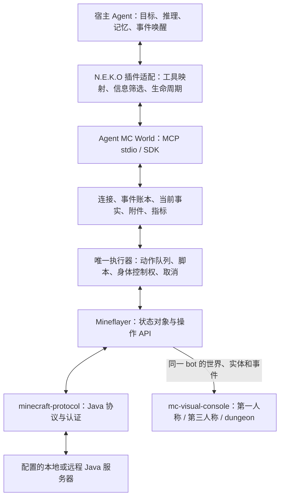

# Mineflayer、Minecraft 协议与 Agent MC World 的接入边界

研究日期：2026-10-13。本文是源码与官方文档研究；没有启动游戏、模型或旧服务，没有连接服务器。N.E.K.O 具体主脑接口另见同目录的接入架构研究。

## 结论

适合移植的是现成的 **Agent MC World 独立 Minecraft 客户端与执行层**。N.E.K.O 应通过它已有的 MCP/SDK 读取世界事实、接收事件、提交动作并核对回执。Mineflayer 是其中的高级 JavaScript API；它底下的 `minecraft-protocol` 才负责 Minecraft 网络包、认证等通信。接入工作主要落在信息和生命周期的衔接，但不能省掉执行器、动作排队、取消和真实结果核验。[Mineflayer 官方说明](https://github.com/PrismarineJS/mineflayer#modules)、[上游架构](https://github.com/jcs130/cortico-world-qiandengji/blob/084234b24f816562d6493da9d57fe9f11b0a7874/docs/architecture.md#架构边界)

## 1. 三种接口分别做什么

| 层 | 核实的职责 | N.E.K.O 的接入位置 |
| --- | --- | --- |
| Minecraft Java 网络协议 | 服务器与客户端之间的版本化数据包；`node-minecraft-protocol` 提供解析、编码、连接和认证 API。 | 通常不直接调用；特殊服务器能力才考虑补充协议适配。 |
| Mineflayer API | 把协议状态变成 `bot`、实体、方块、背包、聊天事件等对象，并提供移动、挖掘、放置、交互等操作。 | 复用已有执行层；不在 Python 插件里重写物理或网络包。 |
| Agent MC World MCP / SDK | 把观察、任务队列、脚本、事件游标、附件和连接生命周期提供给宿主 Agent。 | Python 插件优先接 MCP stdio；TypeScript 宿主也可直接用 `agent-mc-world/client`。 |

证据：[协议 API](https://github.com/PrismarineJS/node-minecraft-protocol/blob/master/docs/API.md#mcclientisserverversioncustompackets)、[Mineflayer API](https://github.com/PrismarineJS/mineflayer/blob/master/docs/api.md)、[本地 Mineflayer 创建底层客户端](<D:/neko-plugins/minecraft_autonomous/local/backend/node_modules/mineflayer/lib/loader.js:105>)、[上游 MCP 入口](https://github.com/jcs130/cortico-world-qiandengji/blob/084234b24f816562d6493da9d57fe9f11b0a7874/src/mcp/stdio.ts#L19-L45)。

图中“插件适配”是建议边界，其余执行路径已经在上游实现。`MinecraftClientWorld` 包装现有 `MinecraftWorldProxy`，通用入口显式关闭 `agentFriendEnabled`，不加载千灯纪账号或传送策略。[源码](https://github.com/jcs130/cortico-world-qiandengji/blob/084234b24f816562d6493da9d57fe9f11b0a7874/src/client/world.ts#L8-L34)

## 2. 信息应分成当前事实、事件和查询结果

| 信息种类 | 现有输入 | 建议如何交给主脑 |
| --- | --- | --- |
| 当前世界事实 | `mc_connection` 的 `status.facts`；位置、生命、食物、物品、附近情况、队列、最近任务结果等。 | 当前值按字段替换，放在本次请求尾部；保留采样时间。 |
| 新发生的事情 | `mc_events`：聊天、系统消息、任务结果、变化快照等，有 `run`、`cursor`、`ts`、`source`、`origin`、正文和可选元数据。 | 按游标只取新增；只用重要事件唤醒，普通变化归并。 |
| 按需详情 | `mc_help`、`mc_script` API 文档、`mc_bag`、`mc_queue`、`mc_blocked`、空间查询、附件。 | 需要时查询；不用每轮重复塞入完整技能说明和全部历史。 |
| 原始证据 | 事件 JSONL、工具日志、哈希附件。 | 保留完整记录及检索入口；长材料只在请求里留关键内容和引用。 |

这里的 `facts` **不是完整的结构化 Mineflayer 对象**：公共契约目前是 `{text, snapshotTypes, parts: [{key, text}]}`。生成引擎为请求准备自足的全量事实；增量背包变化只用于事件，不能直接当作下一次的完整背包。插件可以按 `parts.key` 更新当前事实，但应保留文本原意，不能把它当成已存在的强类型 `health` / `queue.running` JSON 接口。[契约](https://github.com/jcs130/cortico-world-qiandengji/blob/084234b24f816562d6493da9d57fe9f11b0a7874/src/client/contracts.ts#L69-L71)、[本地发行包的事实构造](<D:/neko-plugins/minecraft_autonomous/local/backend/node_modules/agent-mc-world/engine/world.ts:8710>)、[状态返回](https://github.com/jcs130/cortico-world-qiandengji/blob/084234b24f816562d6493da9d57fe9f11b0a7874/src/client/runtime.ts#L88-L92)。

底层不能只监听玩家 `chat`：Mineflayer 的 `message` 包含系统消息与聊天，`actionBar`、标题、计分板、窗口等也有不同入口。服务器指引可能通过这些渠道发送。应保持来源和原文，再决定哪些影响当前目标；同时避免同一条消息从 `message` / `chat` 重复进入上下文。[官方事件契约](https://github.com/PrismarineJS/mineflayer/blob/master/docs/api.md#events)

事件读取需保存返回的 `run` 与 `nextCursor`。`gap` 表示最近缓冲有缺口；切换 `run` 时必须重取基线。读取成功本身不证明主脑已理解或执行。账本把每个事件追加到磁盘，但 `mc_events` 和 `store.range/grep` 当前只查询最近的内存缓冲，默认上限 1024；要跨旧运行检索完整 JSONL，仍需宿主的有界检索入口，不能把“已落盘”说成“现有 MCP 能查任意历史”。[事件实现](https://github.com/jcs130/cortico-world-qiandengji/blob/084234b24f816562d6493da9d57fe9f11b0a7874/src/client/journal.ts#L48-L114)、[MCP 分页与等待](https://github.com/jcs130/cortico-world-qiandengji/blob/084234b24f816562d6493da9d57fe9f11b0a7874/src/mcp/server.ts#L91-L107)。

## 3. 自主行动不是“收到工具返回就成功”

`mc_do` 把有序动作放入持久的身体队列，立即返回任务号。任务继续执行时主脑可以思考或等待事件；后续 `minecraft.task` 事件才报告完成、部分完成、受阻或取消。`mc_queue` 查询进度，`mc_blocked` 查询原始失败原因；重复提交相同动作并不是查进度。`queue: append` 与默认替换待执行任务的语义不同，适配器必须原样保留。[实际发行包工具说明](<D:/neko-plugins/minecraft_autonomous/local/backend/node_modules/agent-mc-world/engine/world.ts:2263>)、[队列读取](<D:/neko-plugins/minecraft_autonomous/local/backend/node_modules/agent-mc-world/engine/world.ts:2613>)、[终态事件](<D:/neko-plugins/minecraft_autonomous/local/backend/node_modules/agent-mc-world/engine/world.ts:8365>)。

建议保留三层结果：**提交已受理 → 任务终态 → 目标的世界变化**。例如“收集木头”要核对物品数量，不能只用导航结束或脚本结束作证。上游的环境说明也明确区分这三层。原生脚本、技能和组合方法共用同一执行器，不应让 UI、主脑、另一个自动循环各自操作 bot。[环境说明](https://github.com/jcs130/cortico-world-qiandengji/blob/084234b24f816562d6493da9d57fe9f11b0a7874/src/client/ENV_PROMPT.md)、[共用执行层](https://github.com/jcs130/cortico-world-qiandengji/blob/084234b24f816562d6493da9d57fe9f11b0a7874/docs/architecture.md#自主学习与编排)

当前普通任务终态主要以文本进入事件，结构化 `taskId` 元数据并非每种终态都统一提供。需要机器级关联时，应补明确的回执契约或保留原任务号及原文，不能依赖中文成功关键词推断整目标成功。[实际终态实现](<D:/neko-plugins/minecraft_autonomous/local/backend/node_modules/agent-mc-world/engine/world.ts:8401>)

## 4. 远程服务器与可视化

连接配置是服务器地址、端口、账号、认证模式与 Java 版本，不要求服务器在本机。上游支持 `offline` 和 `microsoft`，正版授权走微软设备码及独立缓存；协议启动、账号认证、实体入服和画面可用是分别核验的状态。`phase: started` 只是执行环境已启动，不能等同入服成功。[连接源码](<D:/neko-plugins/minecraft_autonomous/local/backend/node_modules/agent-mc-world/engine/bridge.ts:415>)、[状态生命周期](https://github.com/jcs130/cortico-world-qiandengji/blob/084234b24f816562d6493da9d57fe9f11b0a7874/src/client/runtime.ts#L62-L109)、[外部服务器说明](https://github.com/jcs130/cortico-world-qiandengji/blob/084234b24f816562d6493da9d57fe9f11b0a7874/docs/online-accounts.md)。

本项目实际锁定安装为 Mineflayer **4.37.1**、`minecraft-protocol` **1.68.0**。本地 `mineflayer/lib/version.js` 的测试版本列到 **1.21.11**；不能把官网当前 `master` 的更高版本宣传套用到锁定包。自动探测版本不意味着支持所有版本。上游文档也明确没有通用 Bedrock 或 Realms 目录接入，不承诺任意模组服；白名单、反机器人和服务器私有插件仍按真实反馈适配。[安装版本](<D:/neko-plugins/minecraft_autonomous/local/backend/node_modules/mineflayer/package.json:3>)、[测试版本表](<D:/neko-plugins/minecraft_autonomous/local/backend/node_modules/mineflayer/lib/version.js:1>)、[版本检查](<D:/neko-plugins/minecraft_autonomous/local/backend/node_modules/mineflayer/lib/loader.js:118>)、[上游限制](https://github.com/jcs130/cortico-world-qiandengji/blob/084234b24f816562d6493da9d57fe9f11b0a7874/docs/online-accounts.md#三个边界)。

现代可视化已经接在同一个 bot 上：`startModernViewer(bot, ...)` 读取 `bot.world`，监听区块与实体变化，通过 Socket.IO 给页面；第一人称 `/`、第三人称 `/third/`、地下城 `/dungeon/` 是观察同一世界的视图。普通网页观战无需另登录一个 Minecraft 账号。可选的原生 Java 观察者才是另一种单独账号/进程功能。[viewer 入口](<D:/neko-plugins/minecraft_autonomous/local/backend/node_modules/agent-mc-world/engine/bridge.ts:1083>)、[世界数据源](<D:/neko-plugins/minecraft_autonomous/local/backend/node_modules/agent-mc-world/engine/modern-viewer.ts:864>)、[事件订阅](<D:/neko-plugins/minecraft_autonomous/local/backend/node_modules/agent-mc-world/engine/modern-viewer.ts:1208>)、[路径](<D:/neko-plugins/minecraft_autonomous/local/backend/node_modules/agent-mc-world/engine/modern-viewer.ts:702>)。

内置现代素材是 **Java 1.20.6**；协议版本不匹配时现有实现回退基础 viewer。HTTP 页面可打开、Mineflayer 入服、现代模型贴图正确这三者需要分别验收。游戏服务器地址与网页观战地址也应是不同配置。[素材匹配与回退](<D:/neko-plugins/minecraft_autonomous/local/backend/node_modules/agent-mc-world/engine/bridge.ts:1074>)

## 5. “已解耦”的准确范围

已核实的运行期边界：`src/client/` 与 `src/mcp/` 使用包自有契约，独立 MCP/SDK 不要求安装 Cortico；Cortico API 5 World 是可选宿主适配器；千灯纪规则在 `integrations/qiandengji/`，不随通用包分发。目标、长期记忆、推理和唤醒属于接入 Agent；独立客户端不内置另一套主模型。[架构职责表](https://github.com/jcs130/cortico-world-qiandengji/blob/084234b24f816562d6493da9d57fe9f11b0a7874/docs/architecture.md#架构边界)、[MCP 对宿主的契约](https://github.com/jcs130/cortico-world-qiandengji/blob/084234b24f816562d6493da9d57fe9f11b0a7874/src/mcp/server.ts#L41-L51)。

仍保留的构建依赖：`scripts/build-release.ts` 从固定 Cortico 提交提取 `src/worlds/minecraft`，改写类型引用，应用本仓库补丁，生成 `engine/`；少量日志/模板运行工具也在构建时打包。因此目前是**运行与宿主接口已经独立、引擎源码供应仍部分来自 Cortico**，不能说已经把全部 Mineflayer 引擎原生迁成独立源码项目。[生成流程](https://github.com/jcs130/cortico-world-qiandengji/blob/084234b24f816562d6493da9d57fe9f11b0a7874/scripts/build-release.ts#L24-L71)、[上游自述](https://github.com/jcs130/cortico-world-qiandengji/blob/084234b24f816562d6493da9d57fe9f11b0a7874/docs/architecture.md#构建与剩余边界)。

还有生命周期事实需要适配：发行包的引擎代理在意外退出后有 3 秒自动重启；停止标记会阻止重启。N.E.K.O 的“停止”必须结束自己拥有的整条运行生命周期，不只是暂停模型唤醒；否则引擎可能继续重连。此处仅记录源码行为，本次没有启动它。[重启与停止判断](<D:/neko-plugins/minecraft_autonomous/local/backend/node_modules/agent-mc-world/engine/proxy.ts:344>)

## 6. 本轮证据版本与落地建议

| 项目 | 本轮读取版本 |
| --- | --- |
| 上游源码 checkout | `084234b24f816562d6493da9d57fe9f11b0a7874` |
| 本地装配的独立发行包 | `agent-mc-world@0.3.0-next.2`；release 源码 `fb16e2d03e9f321a2c0a583de749c1fa9a0275d3` |
| 引擎来源 | `jcs130/Cortico@8c00fbb022ea82fc9725301fde0437ccc00fdcc9` 加发行补丁 |
| 发行包的现代 viewer | `mc-visual-console@6cd94b034f3064b74771464b192046b6d537f6f0` |
| checkout 最新 viewer 固定版本 | `8536b28516e99ae78a0d11d74f9cef329242c10b`，不同于已装配发行包 |

版本来源：[本仓库固定来源记录](../../backend/source.json)、[源码构建清单](https://github.com/jcs130/cortico-world-qiandengji/blob/084234b24f816562d6493da9d57fe9f11b0a7874/release-sources.json)、[本地生成引擎来源](<D:/neko-plugins/minecraft_autonomous/local/backend/node_modules/agent-mc-world/engine/source.json:1>)。较新的 checkout 中还有额外改动，不应把已装配包描述为最新源码的全部实现。

结合以上事实，建议的移植顺序是：复用固定发行包和同一执行器；把游戏工具接入宿主主脑；实现事件游标、事实替换、按需详情与原文检索；接入现成可视化；再分别验收登录、观察、排队动作、停止和自主持续推进。短工具说明与固定规则保留稳定顺序，当前事实和新增事件放在请求末尾。缓存收益须以宿主实际请求与使用量回执衡量，源码排列本身不能证明缓存命中提升。

当前已有的离线 MCP 验证只能说明工具发现和断开状态传输可用，不能证明已登录远程服务器、可自主生存或现代画面已现场通过；这些仍待后续在用户授权的测试连接中验收。
