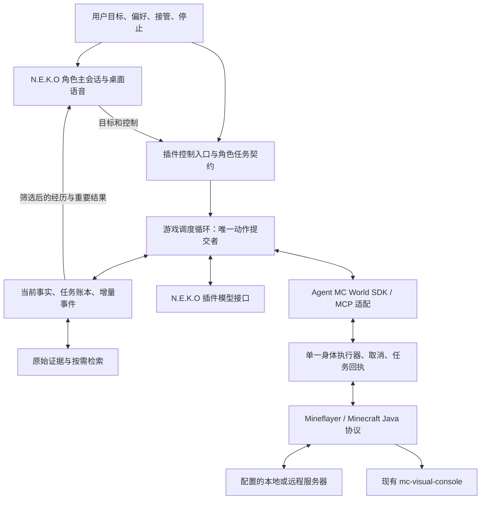

# Cortico 与 N.E.K.O：自主 Minecraft 插件的接入架构

研究日期：2026-10-13。结论来自固定版本的公开源码、接口文档及禁止网络的 MCP 工具发现；没有运行模型、启动游戏或连接服务器。用户报告“Cortico 加现有 Minecraft 插件运行不错”是需要保留的产品基线，本次没有重新进行同模型、同任务的游戏对照实验。

## 结论与建议

Mineflayer 已经解决了大部分客户端观察与操作问题。接入的难点在上一层：**谁保持目标，什么时候继续思考，长动作何时允许打断，结果如何变成下一轮可用的事实**。把工具接通并不能自动保留 Cortico 中的这些行为。

建议继续移植 Agent MC World 的执行能力，不重写 Mineflayer 或现代可视化；先完成源码、构建和可选适配器的独立边界，再以中立协议保存用户 fork 中已核实的事件、回合、取消与事实行为。N.E.K.O 插件实现有明确控制权的游戏调度循环，主会话接收目标和接管指令、了解重要经历并进行角色交流。游戏下一步不依赖一次语音播报结束。后续解耦复查与用户 fork 差异见[迁移边界](fork-improvements-and-decoupling-boundary.md)。

这是拟实现的分工，不是已经实现的功能。插件模型接口不会自动继承 N.E.K.O 主会话的人格、历史和工具，角色约束与游戏经历需要显式传递；如果要求完全共用一个主会话，必须接受现有会话调度边界，或另行增加官方宿主接口。[N3]、[N4]

## 1. 对照范围

| 对象 | 固定证据版本 | 不能据此推断的事情 |
| --- | --- | --- |
| Agent MC World 源码 | `084234b24f816562d6493da9d57fe9f11b0a7874` | 不等同当前安装发行包全部行为 |
| 已装配发行包 | `agent-mc-world@0.3.0-next.2`，来源 `fb16e2d03e9f321a2c0a583de749c1fa9a0275d3` | 离线发现工具不证明游戏可玩 |
| Cortico 引擎来源及宿主研究 | `jcs130/Cortico@8c00fbb022ea82fc9725301fde0437ccc00fdcc9` | 引擎来源不能证明用户实测会话采用了哪套 Persona、配置或模型 |
| N.E.K.O 公开 main | `7bb58c3b0c2d8d74c5afc4ce8524d50187579a46` | 旧试验目录的本地补丁不属于 Market 公共接口 |

来源固定记录见 [backend/source.json](../../backend/source.json)。具体 Minecraft 和 Cortico 证据分别见 [Mineflayer 研究](mineflayer-protocol-and-harness.md)与 [Cortico 宿主研究](cortico-host-architecture.md)。

## 2. 框架差异在哪里

比较的是 Cortico 的 Core/World 契约及其 CortiV Persona 示例，与 N.E.K.O 公开的 Main/Agent/插件机制。CortiV 的可选能力不能算成所有 Cortico 部署必然开启的功能。

| 关注点 | Cortico | N.E.K.O | 对移植的影响 |
| --- | --- | --- | --- |
| 长期运行单元 | Core 管事件与模型/工具轮次；Persona 决定上下文和认知；World 提供环境 | 主会话、角色记忆、Agent 任务分派和插件运行时有各自职责 | 要明确哪一层持续持有游戏目标，不能让一次入口调用冒充自治循环 |
| 没有人说话时继续行动 | World 事件可以直接唤醒模型轮次，支持多种投递时机 | 插件可以主动推送；Main 的主动回应同时受会话、用户活动和播放节奏约束 | 动作调度与角色播报应分开 |
| 长动作与打断 | 队列在 World 继续执行；宿主理解回合结束、屏障和可中断工具 | Main 能调用插件工具；通用 Agent 的任务取消不等于远端身体已经停止 | 必须把停止传到底层并等待回执，迟到模型输出不能再发动作 |
| 当前事实与历史 | `requestFacts` 提供完整读数；Persona 可在每次请求前选择材料 | 文本主动回调有临时指令机制，但公共插件 SDK 没有同等的全请求投影钩子 | 插件自己管理游戏请求时才能完整控制去重和状态尾部替换 |
| 记忆 | Memory 的解释、工作记录、规划和复盘由 Persona 决定 | 有按角色隔离的近期历史、事实、反思和人格记忆流水线 | 游戏执行日志与角色长期记忆需要有明确桥接，二者不是自动共享 |
| 模型接入 | Core/Persona 可安排前台与后台计算 | 插件 Model Gateway 提供模型调用、额度和取消，不代替游戏主循环 | 用同一个模型端点也不代表使用同一个角色会话 |
| 表达与界面 | 可以接其他 World、输出流和演出组件 | 主会话已协调文本、语音、角色和桌面交互 | 可以复用 N.E.K.O 表达能力，不必让每次查状态都产生台词 |

证据：[C1]、[C2]、[C3]、[N1]、[N2]、[N3]、[N4]、[N5]。这些是机制差异，不是性能排名，也没有证明某次失败由某个机制造成。

特别值得复用的是 CortiV 的“保存完整记录、为当前请求另建阅读视图”：保留规则和稳定历史，替换当前状态，按需展开旧内容。该版本 `foreground.enabled` 默认关闭；开启后 `currentStateOnly` 默认开启。后台规划、快速注意力等另有各自开关，不能把这些都归因于用户现有的好效果。[C4]

## 3. 独立运行入口与尚未完成的解耦

源码中存在两条路径：[M1]、[M2]

```text
Cortico Core/Persona → Cortico World adapter → MinecraftClientWorld → 游戏引擎
通用宿主 → MCP → MinecraftAgentClient / AgentJournal → MinecraftClientWorld → 游戏引擎
```

前者传入原生 `WorldHost`；后者自行提供事件账本和调用包装。独立 MCP 已在不安装 Cortico 的情况下完成断连发现检查；构建仍抽取 Cortico 源码，默认导出、可视化演出发现等也需拆分，详见[包审计](agent-mc-world-decoupling-audit.md)。此外，下面的语义没有完整穿过独立接口：

| 契约 | 独立入口中核实的状态 | 需要补齐的边界 |
| --- | --- | --- |
| `trigger` | `AgentJournal.pushEvent()` 保存投递/归档标记，但没有保留 `preempt/interrupt/flush/debounce/piggyback` | 传递原始模式并确定调度规则；不能只靠事件文本猜测 |
| 工具控制字段 | MCP 工具发现仅转换普通 schema 和 `readOnlyHint`；未携带 `barrierAfter/endsTurn/interruptible` | 增加版本化元数据并由宿主执行，而不是把所有调用当普通函数 |
| 结果 `endsTurn` | 原 `ToolOutcome` 有该字段；MCP 映射只给内容、附件和失败状态 | 明确当前唤醒应结束，已受理的游戏任务仍可继续 |
| `onTurnEnded` | 独立 runtime 在 `activeCalls` 降到零时通知 World | 明确真正的模型回合边界；单个工具 RPC 返回不一定结束整轮决策 |
| `modelFacts` | 默认 stdio 入口给空模型名、未知窗口；图片能力来自配置 | 输入预算和图片能力以实际绑定能力为准，不能编造窗口大小 |
| `cognition` | SDK 可选注入；默认 stdio 入口没有后台认知提供者 | 需要它的能力明确降级，后续再接受控计算，避免隐藏第二套主循环 |
| 全历史检索 | 原文追加到 JSONL；现有事件查询读最近内存缓冲，默认 1024 条 | 提供有界归档检索，游标缺口后重取事实，不能声称已能查所有旧运行 |

逐项源码：[M3]、[M4]、[M5]、[M6]。MCP 已向工具 handler 传递请求取消信号；缺口是上述原生宿主策略，并不是“完全无法取消”。Cortico 自身文档把 Minecraft World 最低兼容要求列为 L3、完整为 L4；这不是 MCP 的协议等级，也不表示独立入口完全不能玩，而是它对原生宿主行为的要求。[C2]

因此，当前桥接应描述为“独立执行接口已离线验证”，而非“已完整移植 Cortico 自治能力”。优先在独立客户端的 SDK/MCP 边界补通用契约，N.E.K.O 适配层消费它们；不要把推测出的工具语义硬编码成永久替代品。

## 4. N.E.K.O 三种入口不能混用概念

1. **主会话工具 `@llm_tool` / `register_llm_tool`**：工具在指定角色的对话模型里运行，适合目标、状态、接管和停止；与通用 `@plugin_entry` 不是同一个入口。长任务应返回受理信息，再投递结果。[N2]
2. **通用 Agent 任务分派**：当前是 `DirectTaskExecutor`，主要由完成的对话轮次驱动。结果回调刻意不再次触发分析，防止递归创建任务。因此一条插件执行结果不会自然构成永久游戏循环。[N1]
3. **插件模型接口 `ctx.models.get_client()`**：允许插件提交自己组织的 messages/tools。它不执行工具，也不附加 Main 的人格、历史或工具；主会话和 Agent 推理循环均不参与这次调用。[N3]

`push_message` 的 `respond` 可以请求主动回应；`read` 仅等待后续用户轮次读取；`blind` 不交给模型。排队成功不代表已被模型消费，更不代表游戏动作完成。适合让 Neko 了解重要事件，不适合用它的播报完成作为下一次身体动作的唯一时钟。[N4]、[N6]、[N10]

N.E.K.O 自身的记忆系统有完整的角色知识流程，不能说它“没有记忆”。但插件 `bus.memory` 的近期消息或旧兼容查询接口不能冒充完整人格/语义召回；新插件应使用公开能力或显式的任务上下文交接，不读取旧部署的私有记忆文件。[N5]、[N7]

## 5. 建议的目标架构



图中的控制入口、游戏循环和语义补齐是待实现部分。可视化与行为读取同一个 bot；网页观战不需要另外登录一个游戏账号。[M1]

身体层已有落水、窒息等确定性自保逻辑，应该继续复用；模型只在有必要的决策点参与。可选的快速战术模型、后台构思和长期复盘是各自独立的能力，不应为了接入 Neko 默认再增加多套推理循环。详见 [Cortico 研究的自保与认知边界](cortico-host-architecture.md#6-自保快速决策记忆与方法评价)。

实施取舍：

- **默认目标是独立 N.E.K.O 插件**：复用游戏引擎，同时实现必要的宿主语义；不复制整个 Cortico 部署，不复制账号和私有角色数据。
- **保留原 Cortico 运行方式作对照**：后续相同任务验收比较它与新适配。两套宿主不能同时控制同一身体。
- **只使用 Neko Main 作为唯一游戏推理会话**也能作为另一种设计，但当前公开 SDK 不能保证每轮重取事实、任意整理工具历史及脱离会话持续运行，不选作“效果等价”的默认承诺。
- **本次不接入 Cortico 进程作为后端**：用户已明确要求独立解耦，旧源码和行为仅作为有来源的迁移对照。

角色任务契约至少包含目标、用户限制、游戏角色身份和说话偏好；跨会话传递的是有来源的工作事实和结果。不要把复制一段角色提示词叫作“已经共享 Neko 全部记忆”。Neko 与游戏循环可以分别推理，但只有游戏循环提交普通身体动作；明确停止经过独立取消入口立即生效。

## 6. 信息、上下文与缓存

请求组织目标：

```text
稳定规则 / 角色任务约束 / 短工具目录
仍然相关且配对完整的历史与执行回执
本轮当前目标、完整当前事实、必要的新事件、按需查询结果
```

当前事实是替换视图，不是每轮向历史追加一份。原始服务端指引、聊天、任务回执和附件继续保存，带来源、时间、运行号和游标；服务器文本作为观察内容处理，不能提升为宿主系统指令。观察缺失记为未知，不能用空背包或空队列代替读取失败。

本轮离线发现 **23 个 MCP 工具**，完整工具列表的紧凑 JSON 共 **47,794 个字符**；其中 `mc_do` 为 12,205 字符。这是字符串长度，不是 tokenizer 计数。证据来自已固定发行包的实际 `list_tools`，运行时禁止所有网络，没有连接或模型请求。可用 `backend/check_disconnected.py` 重做基础发现检查；详细本机记录位于被 Git 忽略的 `local/research/mcp-discovery.json`。

因此稳定前缀之外还需要精简默认工具说明、通过 `mc_help` / 脚本 API 查询按需展开。缓存命中并不会消除上下文窗口占用；切换工具集合或改写前缀也可能损失复用。先保证短且顺序稳定，再记录模型实际 usage/缓存数据，不根据排列方式虚报收益。

Cortico 的 `prepareRequest` 是正式的逐请求投影入口；CortiV 的状态尾部替换是现有可参考实现。[C3]、[C4] Neko 文本路径的 `prompt_ephemeral` 已经避免永久保存通知指令，但本轮产生的工具记录仍会留存，临时指令也会被放在该轮工具记录之前。它并不是插件可调用的全局请求整理钩子，不能据此承诺所有模式下“最新事实永远处于最后”。[N8]、[N9]

插件自管游戏模型请求时，可以实现用户要求的稳定前缀和动态尾部。输入预算还必须预留输出、工具协议及图片余量，并使用真实模型窗口/计数或保守上限；现有 `context_chars` 只是字符防线，不是精确 token 预算。

## 7. 完成移植前的验收门槛

- 独立性：核心源码、构建、默认导出和公开类型无需 Cortico；宿主适配器单向依赖核心；未配置的演出/服务器能力不扫描或调用旧服务。
- 事件：普通快照只更新事实；重要事件可唤醒；停止能中断；合批不会丢失独立任务终态或聊天；游标缺口可观测。
- 任务：明确区分提交受理、执行终态和目标达成；长动作持续执行时不重复下发；不确定超时先核验，不盲目重试。
- 上下文：最新事实只有一份，旧原文可查，工具请求与回执配对，稳定前缀可复用，预算包含工具目录。
- 生命周期：一个实例拥有一个 bot；用户停止、卸载及宿主退出可以释放自己拥有的进程和身体；迟到响应不能复活任务。长轮询不能阻塞停止。
- 角色接入：Neko 可了解当前目标与真实进展；游戏能在没有新聊天时继续；语音排队不阻断执行；公开 SDK 的记忆边界如实显示。
- 现场验收：另行明确授权后，在同样服务器、模型和任务条件下比较入服、采集/制作、受阻恢复、停止以及现代画面。没有这步不宣称达到用户现有 Cortico 组合的效果。

当前落地状态：已建立插件标准仓库，固定独立发行包，写入配置和 MCP 传输基础，做过禁止网络的真实工具发现。**插件入口仍是开发基础；自治循环、上述语义桥接及真实游戏验收均未完成。**

## 主要来源

[C1]: https://github.com/jcs130/Cortico/blob/8c00fbb022ea82fc9725301fde0437ccc00fdcc9/docs/worlds.md
[C2]: https://github.com/jcs130/Cortico/blob/8c00fbb022ea82fc9725301fde0437ccc00fdcc9/docs/world-compatibility.md
[C3]: https://github.com/jcs130/Cortico/blob/8c00fbb022ea82fc9725301fde0437ccc00fdcc9/docs/personas.md
[C4]: https://github.com/jcs130/Cortico/blob/8c00fbb022ea82fc9725301fde0437ccc00fdcc9/bots/cortiv/persona/foreground-context.ts
[M1]: https://github.com/jcs130/cortico-world-qiandengji/blob/084234b24f816562d6493da9d57fe9f11b0a7874/docs/architecture.md
[M2]: https://github.com/jcs130/cortico-world-qiandengji/blob/084234b24f816562d6493da9d57fe9f11b0a7874/src/adapters/minecraft.ts
[M3]: https://github.com/jcs130/cortico-world-qiandengji/blob/084234b24f816562d6493da9d57fe9f11b0a7874/src/client/journal.ts
[M4]: https://github.com/jcs130/cortico-world-qiandengji/blob/084234b24f816562d6493da9d57fe9f11b0a7874/src/mcp/server.ts
[M5]: https://github.com/jcs130/cortico-world-qiandengji/blob/084234b24f816562d6493da9d57fe9f11b0a7874/src/client/runtime.ts
[M6]: https://github.com/jcs130/cortico-world-qiandengji/blob/084234b24f816562d6493da9d57fe9f11b0a7874/src/mcp/stdio.ts
[N1]: https://github.com/Project-N-E-K-O/N.E.K.O/blob/7bb58c3b0c2d8d74c5afc4ce8524d50187579a46/docs/zh-CN/architecture/agent-system.md
[N2]: https://github.com/Project-N-E-K-O/N.E.K.O/blob/7bb58c3b0c2d8d74c5afc4ce8524d50187579a46/docs/zh-CN/plugins/tool-calling.md
[N3]: https://github.com/Project-N-E-K-O/N.E.K.O/blob/7bb58c3b0c2d8d74c5afc4ce8524d50187579a46/docs/design/plugin-model-slots.md
[N4]: https://github.com/Project-N-E-K-O/N.E.K.O/blob/7bb58c3b0c2d8d74c5afc4ce8524d50187579a46/main_logic/proactive_delivery.py
[N5]: https://github.com/Project-N-E-K-O/N.E.K.O/blob/7bb58c3b0c2d8d74c5afc4ce8524d50187579a46/docs/zh-CN/architecture/memory-system.md
[N6]: https://github.com/Project-N-E-K-O/N.E.K.O/blob/7bb58c3b0c2d8d74c5afc4ce8524d50187579a46/docs/changelog/plugin-push-message-v2.md
[N7]: https://github.com/Project-N-E-K-O/N.E.K.O/blob/7bb58c3b0c2d8d74c5afc4ce8524d50187579a46/docs/zh-CN/plugins/sdk-reference.md
[N8]: https://github.com/Project-N-E-K-O/N.E.K.O/blob/7bb58c3b0c2d8d74c5afc4ce8524d50187579a46/main_logic/omni_offline_client/_lifecycle.py
[N9]: https://github.com/Project-N-E-K-O/N.E.K.O/blob/7bb58c3b0c2d8d74c5afc4ce8524d50187579a46/main_logic/omni_offline_client/_tools.py
[N10]: https://github.com/Project-N-E-K-O/N.E.K.O/blob/7bb58c3b0c2d8d74c5afc4ce8524d50187579a46/main_logic/core/proactive.py
