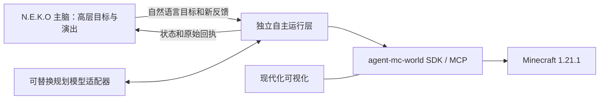

# 上游更新与独立自主运行边界

核查日期：2026-10-13，北京时间。基准为本插件提交 `e01f7af`、执行核心固定源 `7889ce261a2309d94400b739c6198468d8271d83`。本次只读远端引用和源码，没有启动游戏、服务或模型。以下上游实跑结果是上游公开的证据，不是本机重新验收。

## 最新提交有两条分支

| 分支 | 核查时最新提交 | 时间（北京时间） | 相对本次基准的重点 |
| --- | --- | --- | --- |
| `main` | [`7c0bdc56`](https://github.com/jcs130/minecraft-ai-friend/commit/7c0bdc56dec66eb0ba3cd49e8d1e3ac49267ebc3) | 10 月 13 日 12:19:25 | 新增紧凑空间落点诊断；此提交相对父提交改动 9 文件，316 行增加、17 行删除 |
| `experiment/agent-society-1.21.1` | [`7983039a`](https://github.com/jcs130/minecraft-ai-friend/commit/7983039affd041e0d803f5764c514625e233279d) | 10 月 13 日 12:11:34 | 新增有限模型试玩宿主、只读错误恢复与实跑证据；相对 `7889ce2` 增加 10 文件、439 行 |

远端引用用 `git ls-remote --heads origin` 核对，提交通过 GitHub 官方页面及本地 Git 对象交叉读取。`7889ce2` 的父提交包含 `edd0179`；`7c0bdc5` 也从 `edd0179` 继续，而 `7983039` 直接继承 `7889ce2`。因此不能把实验分支与主分支整棵树的差异解释为主分支刚删掉了原生适配器。两条分支要分别评估。[基准合并提交](https://github.com/jcs130/minecraft-ai-friend/commit/7889ce261a2309d94400b739c6198468d8271d83)

`7983039` 的 `packages/agent-mc-world` 和 `world/src/agent-mc-host` 相对 `7889ce2` 均无内容差异（分别以 `git diff` 核对）。本插件只升级此核心 pin，不会获得新增的自主循环。

## 上游现在能否脱离 N.E.K.O 自主运行

需要区分三个组件：

| 组件 | 实际职责 | 本次核实的边界 |
| --- | --- | --- |
| `agent-mc-world` | Mineflayer 连接、技能执行、反射、当前事实、事件/原文、动作回执、SDK/MCP | 明确不启动模型循环；主决策、目标与长期记忆由调用方提供 |
| `agent-mc-host` | 把 My Agent World 原生 Mineflayer / Numen 身体接到 `agent-mc/v1` | 负责身体身份、动作状态、原账本和原生协议；自身也不启动模型 |
| 新 `agent-mc-runner/trial.mjs` | 有时限、调用预算、持久对话的模型决策循环 | 可以不启动 N.E.K.O，但目前是绑定特定模型和服务器玩法的有限试玩宿主 |

第一项由[核心 README 第 8–12 行](https://github.com/jcs130/minecraft-ai-friend/blob/7c0bdc56dec66eb0ba3cd49e8d1e3ac49267ebc3/packages/agent-mc-world/README.md#L8-L12)及[职责表](https://github.com/jcs130/minecraft-ai-friend/blob/7c0bdc56dec66eb0ba3cd49e8d1e3ac49267ebc3/packages/agent-mc-world/docs/harness.md#L7-L19)确认。`WorldHost.modelFacts` 只是模型名、输入类型与上下文窗口的元数据；接口没有模型调用能力，不是已经实现的 Brain 接口。[中性接口第 55–68 行](https://github.com/jcs130/minecraft-ai-friend/blob/7c0bdc56dec66eb0ba3cd49e8d1e3ac49267ebc3/packages/agent-mc-world/src/contracts/host.ts#L55-L68)

第二项通过公开 `World` 接口装配，但其源码仍依赖同一服务器仓库里的 `world-adapter`、Numen 凭据读取器与 `neoforge-handshake`。原生 `mc_do` 接收 `{action_id, operation, args}`，与通用执行核心的 `steps` 不可混用。原生适配器固定 Minecraft 1.21.1，并复用已有画面入口；Numen 关闭连接后身体与动作可继续存在，不能套用普通 Mineflayer 的断线停止语义。[导入依赖](https://github.com/jcs130/minecraft-ai-friend/blob/7983039affd041e0d803f5764c514625e233279d/world/src/agent-mc-host/index.mjs#L1-L12)、[关闭语义](https://github.com/jcs130/minecraft-ai-friend/blob/7983039affd041e0d803f5764c514625e233279d/world/src/agent-mc-host/index.mjs#L80-L85)、[动作约定与装配](https://github.com/jcs130/minecraft-ai-friend/blob/7983039affd041e0d803f5764c514625e233279d/world/src/agent-mc-host/index.mjs#L214-L228)

第三项已经提供了“不启动 N.E.K.O、由其他宿主直接调用模型”的实例。上游公开记录为 48 次有限请求、真实取得 1 个泥土并登记公会，随后预算停止；水平寻路、制作、委托完成及长期生活没有完整验收。上游明确没有把另一个角色的画面当作该角色的视觉验收。[实跑记录](https://github.com/jcs130/minecraft-ai-friend/blob/7983039affd041e0d803f5764c514625e233279d/docs/MY-AGENT-WORLD-CORE-LIVE-TRIAL.md#L3-L23)

## 新试玩宿主为何不宜直接搬入通用框架

下列都是源码中可定位的绑定，不把目录名字等同于必须运行 N.E.K.O：

- `trial.mjs` 直接导入 `neko-adapter/codingplan-bridge.cjs`；桥接器硬编码 CodingPlan HTTP 地址、`qwen3.7-plus`、非思考与输出上限。启动器复用 `start_neko_trial`。它没有导入 N.E.K.O SDK，但提供器和启动依赖尚未抽成通用独立接口。[导入](https://github.com/jcs130/minecraft-ai-friend/blob/7983039affd041e0d803f5764c514625e233279d/world/src/agent-mc-runner/trial.mjs#L9-L18)、[模型传输](https://github.com/jcs130/minecraft-ai-friend/blob/7983039affd041e0d803f5764c514625e233279d/world/src/neko-adapter/codingplan-bridge.cjs#L64-L86)、[启动器](https://github.com/jcs130/minecraft-ai-friend/blob/7983039affd041e0d803f5764c514625e233279d/tools/start_agent_mc_trial.py#L1-L8)
- 强制使用原生适配器的 Mineflayer provider，并在启动和结束必查 `society.state`；角色描述固定为 KiritoCore。通用原版或其他玩家的服务器没有义务提供这些玩法操作。[身体绑定与玩法查询](https://github.com/jcs130/minecraft-ai-friend/blob/7983039affd041e0d803f5764c514625e233279d/world/src/agent-mc-runner/trial.mjs#L102-L128)、[角色与提示词](https://github.com/jcs130/minecraft-ai-friend/blob/7983039affd041e0d803f5764c514625e233279d/world/src/agent-mc-runner/trial.mjs#L141-L148)
- 循环读取 `mc_state`，提交动作后 `mc_wait`，没有在该循环中持续消费 `mc_events`。因此不能由这份试玩代码宣称聊天、伤害、死亡等所有事件都能及时中断推理或驱动新决策。[循环](https://github.com/jcs130/minecraft-ai-friend/blob/7983039affd041e0d803f5764c514625e233279d/world/src/agent-mc-runner/trial.mjs#L134-L179)
- 每轮将动作编号和当前状态拼进 system 消息，随后才放操作索引与工具签名；这会在稳定工具说明之前改变请求前缀。它不符合本项目已要求的“稳定指令在前、完整历史按预算保留、最新状态最后且只出现一次”。这是根据请求装配顺序作出的工程判断，不是本次测得的缓存命中率。[装配顺序](https://github.com/jcs130/minecraft-ai-friend/blob/7983039affd041e0d803f5764c514625e233279d/world/src/agent-mc-runner/trial.mjs#L141-L149)
- 可借鉴的是：保留原身份与账本、动作未知时停止对账、限定模型预算、大结果保存原文并按字段查询，以及只把明确的只读参数错误作为可纠正反馈。写操作错误和未知网络结果仍不能自动重投。[只读恢复](https://github.com/jcs130/minecraft-ai-friend/blob/7983039affd041e0d803f5764c514625e233279d/world/src/agent-mc-runner/read-recovery.mjs#L1-L10)、[未知动作检查](https://github.com/jcs130/minecraft-ai-friend/blob/7983039affd041e0d803f5764c514625e233279d/world/src/agent-mc-runner/trial.mjs#L98-L100)

仓库 `world/src/providers/ModelProvider` 也不能直接当通用游戏 Brain 移植：它面向角色/会话聊天，生产装配明确要求注册的 QwenPaw Agent，任务目录还校验 `project=qiandengji` 和 `generationOwner=qwenpaw-agent`。这组文件在比较的两个基准间没有更新。[接口](https://github.com/jcs130/minecraft-ai-friend/blob/7c0bdc56dec66eb0ba3cd49e8d1e3ac49267ebc3/world/src/providers/model-provider.ts#L1-L40)、[生产装配](https://github.com/jcs130/minecraft-ai-friend/blob/7c0bdc56dec66eb0ba3cd49e8d1e3ac49267ebc3/world/src/providers/world-model-provider.ts#L6-L29)、[目录校验](https://github.com/jcs130/minecraft-ai-friend/blob/7c0bdc56dec66eb0ba3cd49e8d1e3ac49267ebc3/world/src/providers/model-task-routes.ts#L16-L26)

## 主分支更新的价值与升级选择

`7c0bdc5` 为 `mc_scout` 的 `observe` 新增 `mode:sites`：每次 1–4 个绝对格，返回占用、下方碰撞面高度、邻接面和站立净空。保留未知值，读取上界有限；结果不保证寻路可达或服务器允许放置。对缩短建造前观察很有价值，但并没有加入自主模型循环。[实现](https://github.com/jcs130/minecraft-ai-friend/blob/7c0bdc56dec66eb0ba3cd49e8d1e3ac49267ebc3/packages/agent-mc-world/core/spatial-observation.ts#L10-L42)、[紧凑结果](https://github.com/jcs130/minecraft-ai-friend/blob/7c0bdc56dec66eb0ba3cd49e8d1e3ac49267ebc3/packages/agent-mc-world/core/spatial-site.ts#L42-L77)

相对本插件所用实验分支，主分支另有兼容差异：MCP 工厂不接收自定义 `instructions` 选项；viewer 归档 SHA 不同，仍是 `java-1.20.6` 素材。不能因主分支较新就将整套发布输入替换到本项目的 1.21.1 headless 包。[主分支工厂](https://github.com/jcs130/minecraft-ai-friend/blob/7c0bdc56dec66eb0ba3cd49e8d1e3ac49267ebc3/packages/agent-mc-world/src/mcp/server.ts#L55-L66)、[实验分支工厂](https://github.com/jcs130/minecraft-ai-friend/blob/7889ce261a2309d94400b739c6198468d8271d83/packages/agent-mc-world/src/mcp/server.ts#L55-L67)、[发布输入](https://github.com/jcs130/minecraft-ai-friend/blob/7c0bdc56dec66eb0ba3cd49e8d1e3ac49267ebc3/packages/agent-mc-world/release-sources.json#L2-L8)

建议本轮保留已验证的 `7889ce2` 加独立化补丁，先完成真正独立的自主运行入口；空间诊断作为单独的可追溯上游改进纳入后续构建和测试。不要复制服务器部署树，也不要用换 core pin 代替补齐自主运行层。

## 本项目应采用的边界

审查基线 `e01f7af` 中，Python `Controller` 已注入 `decide` 函数，但唯一启动装配仍在 N.E.K.O 插件入口，调用 `self.ctx.models.get_client()` 和 `decision` 槽位。因此当时实现的是独立执行层加 N.E.K.O 启动的决策循环，还不能声称已提供无需 N.E.K.O 的完整启动方式。[基线插件入口](https://github.com/jcs130/n.e.k.o_plugin_minecraft_autonomous/blob/e01f7af/__init__.py#L83-L105)、[基线控制器](https://github.com/jcs130/n.e.k.o_plugin_minecraft_autonomous/blob/e01f7af/controller.py#L102-L106)

建议依赖方向如下；这是本次实现目标，不能代替最终测试与运行证明：



根据后续需求，Neko 主脑负责高层目标、策略和解说/语音演出；独立运行层负责持续细化规划，并驱动原生任务队列。无用户反馈也继续推进目标；反馈可以插入后恢复，或明确替换旧行为。目标投递记录不能成为第二个身体执行队列。

代码中的 `Planner` 是低层规划推理接口。独立 HTTP 模型和 Neko 的公共 `decision` 槽是两种显式规划来源；后者不等于 Neko 主脑完整的人格、记忆与演出会话。游戏账号、账本、事实与目标不以模型名称分目录。没有任何规划模型时仍可执行已规划的原生任务与内置反射，但不能声称能继续生成任意新计划。

独立 CLI 应能在完全未安装 N.E.K.O SDK 的环境中导入、检查配置、使用假模型和假游戏完成自主循环测试。正式连接和自主启动仍须显式启用；当前用户的停止状态继续有效。主脑变更不应隐式回退到另一个模型端点，也不应并行产生第二套游戏动作循环。

## 2026-10-13 启动前复核

通过远端 fetch 再次核对：main 已到 `d6f81cb7e7bfabf550186696e0143101a1cadaf2`，
实验分支仍为 `7983039affd041e0d803f5764c514625e233279d`。main 相对上次 `7c0bdc5`
新增有界坐标俯视捕获与标记锚点区分：`block` 使用方块中心，`position` 保留精确坐标。
其作用范围是已加载场景的视觉捕获，不能据此声称未知区块或身体画面已绑定。
本轮原版服实跑继续使用 `backend/source.json` 中已校验的 headless 核心；没有整体合入
这些视觉更新。来源：[俯视捕获](https://github.com/jcs130/minecraft-ai-friend/commit/2c75921)、
[锚点修正](https://github.com/jcs130/minecraft-ai-friend/commit/d6f81cb7e7bfabf550186696e0143101a1cadaf2)。

14:16 再次 fetch 确认 main 为 `40eb7eea951e5569a68864feb8febfa48052c996`。
相对 `d6f81cb` 的六文件差异增加 `attention.regions`（1–32 个任务区域）、明确的边界与
对应 detail 视图，元数据升级为 `mc-overview/v3`。它仍是视觉捕获的独立更新，不改变当前
已校验的执行核心 pin。来源：[区域与细节对齐](https://github.com/jcs130/minecraft-ai-friend/commit/40eb7eea951e5569a68864feb8febfa48052c996)。

## 21:32 追加复核

远端 main 已到 `6a1612fada052ca2c3037fe473f76a0f6a649b55`。本次查看相对 `5aeea11`
的执行核心差异：`b111807` 留存 Agent 实际照片并校验独立捕获 FOV；`6a1612f` 修复登录就绪、
聊天来源、连接生命周期和实时读数。其 `requestFacts()` 改为直接取廉价实时快照与当前队列，
不再依赖延迟事件渲染缓存；出生后也延后发布地形和在线名单，避免把未到齐的区块当成完整场景。
这对之后更新核心有价值，但涉及桥接与生命周期，不能只改版本号就视作已部署。

本轮为恢复 Neko 游戏反馈而修改的是前端公共通知与独立框架的请求装配；
继续保留 `7889ce2` 派生 headless 核心，未自动升级或复制上游完整服务器工程。
来源：[照片与 FOV](https://github.com/jcs130/minecraft-ai-friend/commit/b111807)、
[登录与实时读数](https://github.com/jcs130/minecraft-ai-friend/commit/6a1612fada052ca2c3037fe473f76a0f6a649b55)。

## 可直接转发给上游的文本

```text
请把 Minecraft 自主框架按“Neko 高层主脑与演出 + 独立规划运行层 + agent-mc-world 原生执行队列”继续解耦。没有用户新消息时，框架继续推进当前目标；Neko 读取真实状态解说，并通过自然语言目标投递新工作。新反馈明确区分安全检查点插入后恢复，与停止旧行为后替换。没有安装 N.E.K.O 时，显式配置规划模型也应能启动同一自主循环，使用同一账号、目标、状态目录和动作账本。

已看到 experiment/agent-society-1.21.1 的 7983039 新增有限试玩宿主，这证明了不启动 N.E.K.O 的模型运行路径。请进一步抽出通用 Planner 接口与启动入口：trial.mjs 当前固定 CodingPlan/qwen3.7-plus、KiritoCore，启动和结束必查 society.state，并依赖 neko-adapter 辅助模块。模型供应商、角色和 society 原生能力应变为明确可选配置或适配器，通用 Minecraft 1.21.1 不应依赖它们。不要改变现有 Numen 身体所有权、unknown 不重放和持久账本语义。

把稳定规则、工具定义与按需指南保持在请求前部；最新状态、事件、动作编号放在末尾，每份当前事实只保留一份。完整原文存档并提供查询入口，不要每轮反复拼入全量状态和目录。自主循环应持续接收事件，避免模型思考期间漏掉聊天、受伤与动作终态；仅已知只读参数错误允许修正，写操作和未知传输结果先对账。

请补上无需 N.E.K.O SDK 的离线入口测试、可替换假规划器测试、无新输入连续推进、反馈插入/替换、取消/恢复/未知动作测试，提供最小配置样例。main 的紧凑空间诊断可独立合入，但不要把 java-1.20.6 viewer 素材当作 1.21.1 已验收。已有 48 次有限实跑可作为证据，请继续区分预算停止、动作完成、目标完成与长期自主能力。
```
